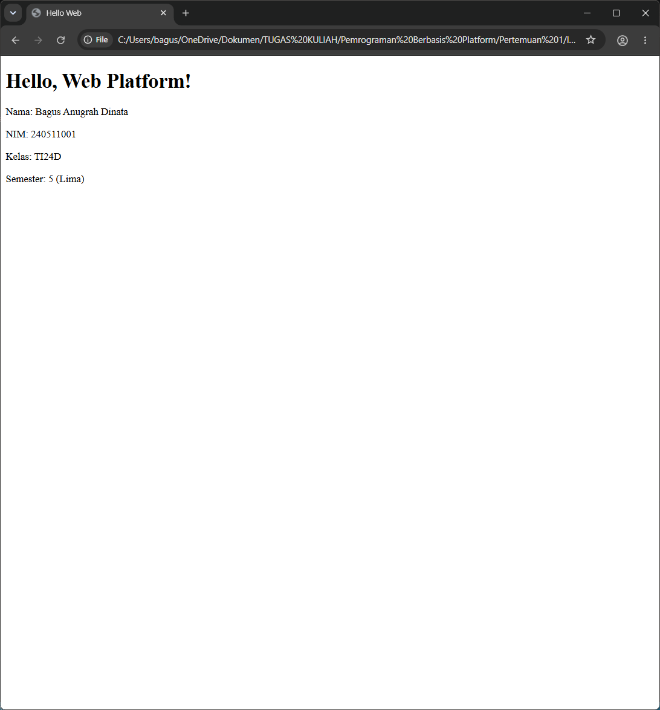
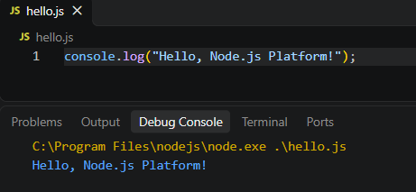
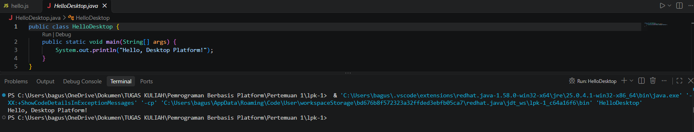
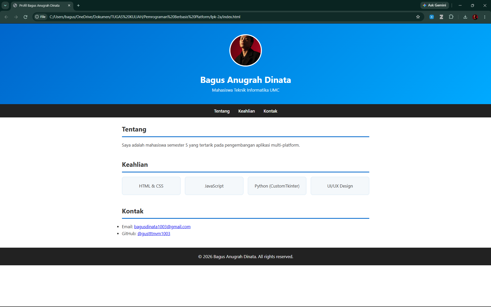
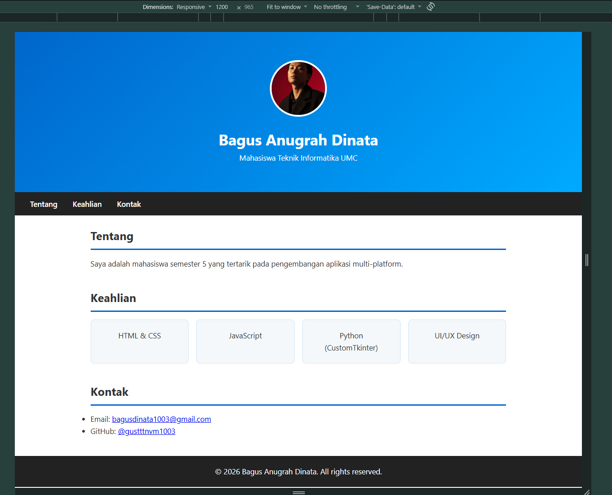
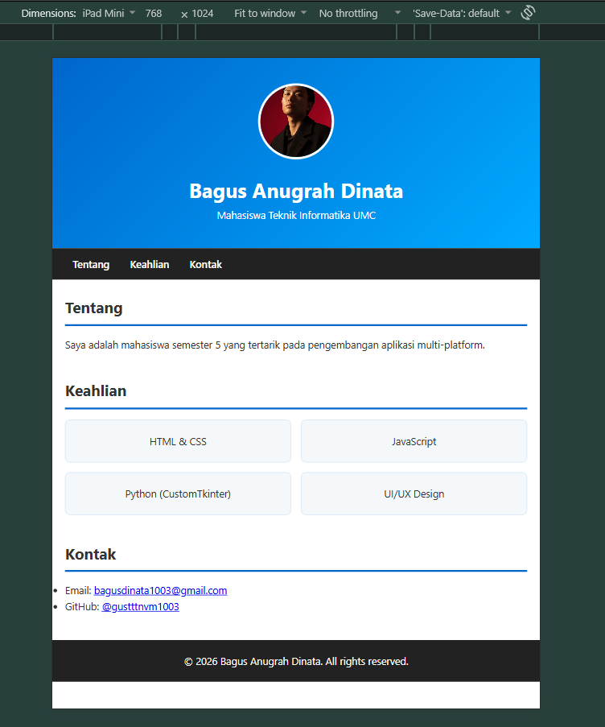
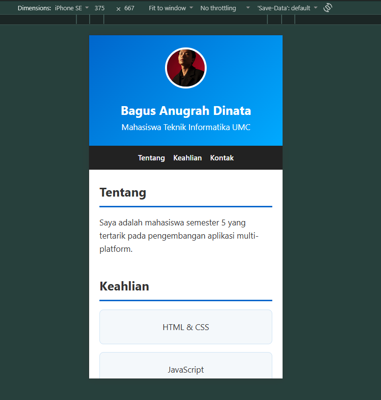

# 🚀 Praktikum Pemrograman Berbasis Platform (PBP)

Selamat datang di repository GitHub saya! Repository ini berisi kumpulan tugas dan Lembar Kerja Praktikum (LKP) untuk mata kuliah **Pemrograman Berbasis Platform**, Program Studi S1 Teknik Informatika, Universitas Muhammadiyah Cirebon.

## 👨‍💻 Profil Mahasiswa

*   **Nama:** Bagus Anugrah Dinata
*   **NIM:** 240511001
*   **Program Studi:** S1 Teknik Informatika
*   **Universitas:** Universitas Muhammadiyah Cirebon
*   **Tahun Akademik:** 2026

## 📁 Daftar Pertemuan Praktikum

Di bawah ini adalah daftar tautan cepat untuk mengakses hasil pengerjaan setiap lembar kerja praktikum:

| Pertemuan | Topik Pembahasan | Direktori / Folder |
| :---: | :--- | :--- |
| **1** | Pengenalan Pemrograman Berbasis Platform & Setup Environment | [📂 LKP 1 - Setup & Hello World](./lpk-1) |
| **2** | HTML5 & CSS Dasar (Halaman Profil Pribadi) | [📂 LKP 2A - Profil Statis](./lpk-2a) |
| **3** | Responsive Design (Media Queries) | [📂 LKP 2B - Profil Responsif](./lpk-2b) |

## 📸 Screenshot Hasil Eksekusi

### Pertemuan 1: Setup Environment (LKP 1)
### Pertemuan 1: Setup Environment (LKP 1)

### Pertemuan 2: Halaman Profil Statis (LKP 2A)

### Pertemuan 3: Responsive Design (LKP 2B)
**Tampilan Desktop (1200px)**

**Tampilan Tablet (768px)**

**Tampilan Mobile (375px)**

---
*Dibuat untuk memenuhi tugas mata kuliah Pemrograman Berbasis Platform (PBP).*
